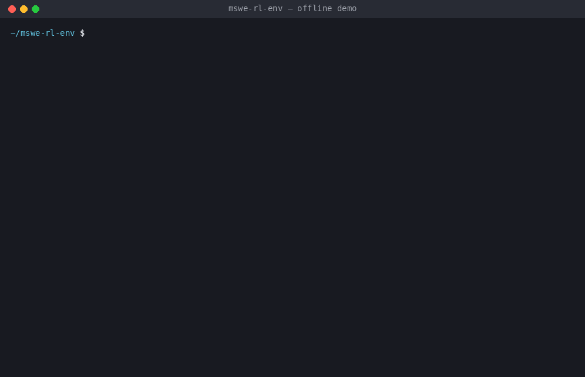
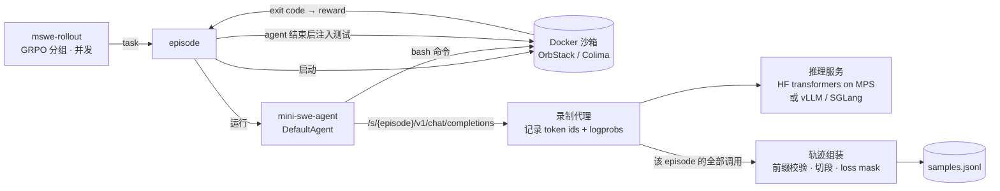

# mswe-rl-env

把 [mini-swe-agent](https://github.com/SWE-agent/mini-swe-agent) 改造成**强化学习 rollout 环境**：agent 代码一行不改，在它和模型之间加一个录制代理，采集 **token 级轨迹 + logprob**，在 Docker 沙箱里用**隐藏测试**给出可验证奖励，最后组装成 GRPO 可以直接训练的样本。

整个流程可以在 M1 MacBook 上本地跑通，不需要 GPU。



> 上面的 GIF 是 `bash demo/run_demo.sh` 的真实输出（agent 是子模块里真实的 mini-swe-agent v2.4.6，**模型是脚本化的假模型**，沙箱为 `local` 后端）。六段分别是：
> 1. **任务集自检**（不需要模型）：未修改的仓库必须测试失败，参考解必须测试通过。
> 2. **批量 rollout**：3 个任务 × 每组 2 个 episode。`fix_word_count` 的脚本故意给了一个不完整的修复，隐藏测试判为 0 分。
> 3. **历史截断实验**：agent 只保留最近 2 条消息，token 前缀在第 3 次调用时断开，轨迹被自动切成 2 段，两段共享同一个 episode 的奖励。
> 4. **logprob 校验**：对录下来的 token 序列重新做一次前向，逐 token 与 rollout 记录的 logprob 对比。
> 5. **rollout 报告**：通过率，以及有多少组同时包含成功和失败（GRPO 只能从这样的组里学到东西）。
> 6. **训练器视角**：绿色是策略采样的 token（`loss_mask=1`，带 rollout logprob），灰色是 prompt 和工具输出（`loss_mask=0`）。

## 当前状态

- **已验证**：33 个测试中的 32 个（单元测试 + 用真实 mini-swe-agent 跑的端到端测试，剩下 1 个是 Docker 后端测试）和离线演示，模型均为脚本化假模型。
- **尚未验证**：真实模型上的运行（HF 和 MLX 两个引擎）、Docker 后端、HumanEvalFix 数据集的下载与转换。下文相关命令都按设计写好，但还没有实测结果，欢迎按步骤跑通后补充数字。
- 已知局限见文末。

---

## 为什么需要它

用 RL 训练 coding agent 时，rollout 这一步有几个容易出错、出错了还很难察觉的地方：

| 问题 | 后果 | 本项目的做法 |
|---|---|---|
| 训练时把对话文本**重新分词** | token 与推理时不一致，重要性采样比率失真（训推不一致） | 代理直接记录推理引擎实际吃进和吐出的 token ids |
| agent **截断或改写历史** | 多轮调用之间的 token 前缀不再连续，硬拼会造出模型从未见过的序列 | 逐次校验前缀，断开就切段，并记录断点位置 |
| 工具输出也参与 loss | 模型被训练去"预测"环境的输出 | `loss_mask` 只给策略生成的 token 记 1 |
| 容器崩了、服务挂了也给 0 分 | 把基础设施故障当成策略失败去惩罚 | 归为 `env_error`，`reward=None`，不产出样本 |
| 测试文件在 agent 运行时可见 | agent 可能去改测试来骗奖励 | agent 结束后才把测试拷进沙箱 |

## 架构



mini-swe-agent 只通过两个适配器接入（见 `mswe_rl/agents/mini_swe.py`）：

- **`SandboxEnv`**：实现 mini-swe-agent v2 的 Environment 协议，背后可以是 Docker 或本地目录。
- **`ProxyTextModel`**：实现 Model 协议，直接复用 mini-swe-agent 自己的文本动作解析器和观察模板（即 `mini_textbased.yaml`）。不依赖 tool calling，任何小模型都能用。也可以用 `--model-backend litellm` 切换到官方的 `LitellmTextbasedModel`。

## 快速开始（M1 / Apple Silicon）

### 0. 准备

```bash
# uv：Python 环境管理
curl -LsSf https://astral.sh/uv/install.sh | sh

# OrbStack：比 Docker Desktop 轻量，自带 docker 命令（只有 docker 后端需要）
brew install --cask orbstack
orb start            # 第一次装完建议先打开一次 OrbStack 应用完成授权
docker ps            # 能正常输出就说明可用
```

> 想用纯开源方案可以换成 Colima：`brew install colima docker && colima start --cpu 4 --memory 6`。代码只调用 `docker` 命令，两者都能直接用。

### 1. 安装

```bash
cd ~/mswe-rl-env
git submodule update --init      # 拉取 third_party/mini-swe-agent（固定在 v2.4.6）
uv sync                          # 创建 .venv，以可编辑方式安装 mini-swe-agent 子模块
uv run pytest                    # 33 个测试；OrbStack 运行时 docker 后端测试也会执行
```

### 2. 离线演示（不需要模型）

```bash
bash demo/run_demo.sh                    # 本地目录沙箱，几秒钟跑完
BACKEND=docker bash demo/run_demo.sh     # 换成 Docker 沙箱（需要 orb start）
```

首次用 docker 后端会拉取 `python:3.11-slim`（有 arm64 版本，M1 上原生运行）。

### 3. 换成真实模型（Hugging Face 管理）

模型权重统一放在 Hugging Face 缓存（默认 `~/.cache/huggingface`，可以用 `HF_HOME` 改位置）。推理服务按仓库 ID 加载，可以用 `--revision` 锁定版本，`--offline` 只读本地缓存、不联网。

推理服务有两个引擎，返回格式完全相同，代理和 rollout 不用改：

| 引擎 | 适用 | 模型 |
|---|---|---|
| `--engine mlx`（**M1 推荐**） | Apple Silicon，速度快，支持 4/8-bit 量化 | `mlx-community/*`，如 `mlx-community/Qwen3-1.7B-4bit` |
| `--engine hf`（默认） | MPS / CPU / CUDA，与 PyTorch 训练侧权重一致 | 原始 HF 仓库，如 `Qwen/Qwen3-1.7B` |

**MLX（推荐）**

```bash
uv sync --extra mlx
export HF_ENDPOINT=https://hf-mirror.com                # 国内网络建议设置镜像
uv run hf download mlx-community/Qwen3-1.7B-4bit
uv run mswe-infer --engine mlx --model mlx-community/Qwen3-1.7B-4bit --offline --port 8000
```

> 注意：用 4-bit MLX 模型做 rollout、再用 bf16 的 PyTorch 模型训练，两边的 logprob 会有明显差距（训推不一致）。只验证链路没问题；反过来也可以专门拿它做实验，度量量化带来的不一致有多大。

**HF transformers**

```bash
uv sync --extra infer                                   # 安装 torch / transformers / huggingface_hub

export HF_ENDPOINT=https://hf-mirror.com                # 国内网络建议设置镜像
uv run hf download Qwen/Qwen3-1.7B                      # 下载一次，之后都走缓存

uv run mswe-infer --model Qwen/Qwen3-1.7B --offline --port 8000
```

**之后的步骤两种引擎相同**（推理服务在 8000 端口运行）：

```bash
# 终端 2：录制代理
uv run mswe-proxy --upstream http://127.0.0.1:8000 --port 8100

# 终端 3：采集 rollout，并查看训练样本
uv run mswe-rollout --agent mini --model Qwen/Qwen3-1.7B --backend docker \
    --group-size 2 --concurrency 1 --max-tokens 512 --out runs/qwen/samples.jsonl
uv run mswe-inspect runs/qwen/samples.jsonl --tokenizer Qwen/Qwen3-1.7B
```

### 4. 校验采到的数据

```bash
# 用 rollout 时的同一个模型重算：差值应接近 0，说明 token、分段、mask、logprob 对齐都正确
uv run mswe-verify-logprobs runs/qwen/samples.jsonl --engine mlx --model mlx-community/Qwen3-1.7B-4bit

# 换成训练侧会用的权重重算：差值就是训推不一致的大小（这里是量化带来的）
uv run mswe-verify-logprobs runs/qwen/samples.jsonl --engine hf --model Qwen/Qwen3-1.7B
```

每个样本只做一次完整前向，比较 `loss_mask=1` 位置上的 `log p(token | 前缀)`。有 token 超过容差（默认 0.05）时退出码为 1，并指出差值最大的 token 位置。

### 5. 在 HumanEvalFix 上评估环境

[HumanEvalFix](https://huggingface.co/datasets/bigcode/humanevalpack)（MIT）是 HumanEval 的修 bug 版本：164 个 Python 函数，每个带一处人工植入的 bug、正确解法和单元测试。单文件、bug 只有一两行，适合小模型。

```bash
uv run mswe-make-humanevalfix --out tasks/humanevalfix       # 从 HF 下载并转换（也可用 --input 指定本地的 .parquet 或 .jsonl）
uv run mswe-check-tasks tasks/humanevalfix                   # 164 题都应"原始版本失败、参考解通过"

uv run mswe-rollout --tasks tasks/humanevalfix --agent mini --model mlx-community/Qwen3-1.7B-4bit \
    --backend docker --group-size 4 --concurrency 1 --max-tokens 512 --out runs/hef/samples.jsonl
uv run mswe-report runs/hef/samples.jsonl --tasks tasks/humanevalfix --json runs/hef/report.json
```

`mswe-report` 给出通过率、环境错误率、前缀断裂比例、每个样本的 token 数，以及按 bug 类型的通过率。最关键的一项是 **mixed groups**：同一题的几次尝试里既有成功也有失败的组数。全对或全错的组优势为 0，对 GRPO 没有任何学习信号，所以这个数字衡量任务集的难度和模型是否匹配。太难可以换更大的模型；太简单可以用 `--hint none` 去掉 docstring。

> HumanEval 流传很广，模型很可能见过原题，这里的通过率只用来衡量环境的奖励信号，不能当作模型能力的评测成绩。

**M1 上的预期**：

- 内存：MLX 的 Qwen3-1.7B-4bit 只需 1 GB 左右；HF 引擎用默认 fp32 约占 7 GB，8 GB 内存的机器请改用 `Qwen/Qwen3-0.6B` 或加 `--dtype bfloat16`。
- 速度：MLX 明显快于 HF transformers + MPS。`--concurrency` 设为 1 即可，推理服务内部本来就是串行的。
- 效果：小模型解题率低、奖励大多为 0 是正常的。这里验证的是**链路正确性**（token 对齐、mask、切段、故障隔离），不是模型能力。
- 想看前缀断开的真实案例，可以给 `mswe-infer` 加 `--enable-thinking`：Qwen3 的 chat template 会在后续轮次里删掉旧的 `<think>` 块，于是前缀断开，统计里的 `prefix breaks` 会变成非零。

### 6. 换成 vLLM / SGLang（有 GPU 时）

代理只要求上游返回 `prompt_token_ids`、`choices[0].token_ids` 和 `choices[0].logprobs`。在新版 vLLM 上，可以让代理给每个请求注入相应参数：

```bash
uv run mswe-proxy --upstream http://gpu-box:8000 \
    --inject '{"logprobs": true, "return_token_ids": true}'
```

参数名在不同版本之间变过，请以你所用版本的文档为准。如果拿不到 token ids，代理会直接报错，**不会**退回到重新分词。

## 输出格式

`samples.jsonl` 每行是一个训练样本（一段前缀连续的轨迹）：

| 字段 | 含义 |
|---|---|
| `tokens` | 第一次调用的 prompt，加上之后每轮的（环境追加内容 + 模型生成内容） |
| `loss_mask` | 1 表示策略采样的 token，0 表示 prompt、工具输出和环境文本 |
| `rollout_logprobs` | 采样 token 的 rollout logprob（温度为 1 时的原始分布），其余位置为 0 |
| `logprobs_complete` | 推理引擎是否为每个采样 token 都返回了 logprob |
| `prompt_length` / `response_length` | 与常见 RL 框架的 prompt/response 划分对应 |
| `reward` | 1.0 / 0.0；一个 episode 的所有分段共享同一个奖励 |
| `group_id` | 任务名，GRPO 在同一组内计算优势 |
| `episode_id` / `segment_index` / `num_segments` | 追溯来源，以及截断造成的切段信息 |

另有 `samples.jsonl.episodes.jsonl`，每行记录一个 episode 的状态、奖励、agent 退出原因和前缀断点详情。录制代理还会把每次原始调用写到 `--record-dir`。

## 关键设计

1. **只用推理引擎给出的 token ids，绝不重新分词。** 文本经过"解码再编码"不一定能还原（空格合并、特殊 token、chat template 改写），用错 token 计算出的重要性采样比率是错的。
2. **前缀校验和切段。** 第 k 次调用的 prompt 必须以第 k−1 次的"prompt + completion"开头，多出来的部分就是环境追加的内容（mask 为 0）。不满足时就开新的一段，并记录 `mismatch_pos`，方便定位是截断还是模板改写导致的。
3. **奖励与故障分离。** 只有"agent 正常结束、测试正常执行"的 episode 才有 0 或 1 的奖励。容器启动失败、模型服务不可达、agent 进程崩溃，一律记为 `env_error`、`reward=None`，不产出样本。（这一条是演示时发现的 bug：最初 agent 崩溃会被记为 0 分，见 git 历史。）
4. **隐藏测试。** 测试目录在 agent 结束后才拷进沙箱，agent 看不到也改不了。
5. **格式错误时保留模型回复。** mini-swe-agent 在格式错误时只把错误提示加进历史，模型原本的回复会丢掉，导致下一次调用的前缀断开。`ProxyTextModel` 会先把回复补回历史，再加错误提示，保证前缀连续。
6. **沙箱默认断网**（`--network none`，内存上限 2 GB），每个 episode 用一个新容器。

## 自定义任务

```
tasks/<task_set>/<name>/
  task.yaml        instruction（任务描述）、image（默认 python:3.11-slim）、metadata（可选）
  repo/            拷进沙箱 /workspace 的代码
  tests/test.sh    agent 结束后运行；退出码 0 = 通过。可以读取 $WORKSPACE、$TESTS_DIR
  solution/        可选的参考解，覆盖到工作区后应通过测试；agent 看不到，供 mswe-check-tasks 使用
```

新增任务后先运行 `uv run mswe-check-tasks tasks/<task_set>`，确认奖励判定是对的。

## 命令一览

| 命令 | 作用 |
|---|---|
| `mswe-infer` | 本地推理服务（`--engine hf` 或 `mlx`），返回 token ids 和 logprobs |
| `mswe-proxy` | 录制代理 |
| `mswe-rollout` | 批量采集 rollout，输出 `samples.jsonl` |
| `mswe-inspect` | 按 loss mask 着色查看样本 |
| `mswe-verify-logprobs` | 重算 logprob，校验采到的数据 |
| `mswe-report` | 汇总 rollout：通过率、奖励信号、前缀断裂 |
| `mswe-check-tasks` | 不用模型，校验任务集的奖励判定 |
| `mswe-make-humanevalfix` | 把 HumanEvalFix 转成任务集 |

## 项目结构

```
mswe_rl/
  proxy.py            OpenAI 兼容的录制代理（按 episode 分 session）
  infer_server.py     本地推理服务：HF 缓存加载，MLX 或 transformers 引擎
  sandbox.py          Sandbox 协议，DockerSandbox / LocalSandbox，测试注入，故障分类
  tasks.py            任务格式与加载
  episode.py          单个 episode：沙箱 → agent → 测试 → 组装
  trajectory.py       前缀校验、切段、loss mask、样本格式
  rollout.py          批量 rollout（GRPO 分组、并发、统计）
  inspect_samples.py  按 loss mask 着色展示样本
  verify_logprobs.py  用一次前向重算 logprob 并与 rollout 对比
  report.py           rollout 结果汇总
  check_tasks.py      任务集自检（原始版本失败、参考解通过）
  humanevalfix.py     HumanEvalFix → 任务集
  agents/
    mini_swe.py       mini-swe-agent v2 适配器（SandboxEnv / ProxyTextModel）
    simple.py         约 60 行的参考 agent，支持历史截断
  testing/
    fake_server.py    脚本化假模型（bigram logprob，可被精确重算）
    toy_tokenizer.py  字节级 ChatML 分词器
tasks/toy/            3 个示例修 bug 任务（含参考解）
demo/                 演示脚本、假模型脚本、GIF 渲染器
tests/                单元测试 + 端到端测试（真实 mini-swe-agent）
third_party/mini-swe-agent   git 子模块，固定在 v2.4.6
```

## 开发

```bash
uv run pytest                 # 测试
uv run ruff check .           # lint
uv run ruff format .          # 格式化
```

## 录制你自己的 GIF

在真实模型上跑完之后，可以用同一个渲染器生成 GIF：

```bash
uv run mswe-rollout --agent mini --model Qwen/Qwen3-1.7B --backend docker --color \
    --out runs/qwen/samples.jsonl > runs/qwen.log 2>&1
uv run python demo/render_gif.py --cmd "uv run mswe-rollout --agent mini --model Qwen/Qwen3-1.7B" \
    --log runs/qwen.log --out docs/qwen.gif --title "mswe-rl-env — Qwen3-1.7B on M1"
```

## 已知局限

- **logprob 的口径**：记录的是温度为 1、未做 top-p 截断的原始分布下的 logprob。采样时如果用了其他温度或 top-p，它不等于行为策略的概率，不能直接当作 π_old 计算重要性采样比率。
- **测试在 agent 用过的容器里运行**：测试文件是事后注入的，但 agent 仍可能通过修改解释器环境或留下后台进程来影响测试结果。
- **命令超时后容器内的进程不会被终止**，只是 `docker exec` 客户端退出；容器也没有限制 CPU 和进程数。
- **切段后的样本权重**：一个 episode 被切成多段时每段都带同一个奖励，训练侧需要自行决定如何归一化。
- **推理服务只用于验证链路**：串行、无批处理、多轮之间不复用 KV cache。
- 只支持文本动作，不支持 tool calling 和流式输出。

## 后续计划

- [ ] 在真实模型上跑通并补充 HumanEvalFix 的实测数字
- [ ] 记录采样参数与行为策略 logprob；测试改到全新容器中运行；容器内超时终止
- [ ] slime（`custom_generate_func`）和 verl（AgentLoop）的样本适配器
- [ ] 支持 tool calling 版本的 mini-swe-agent（`LitellmModel`）
